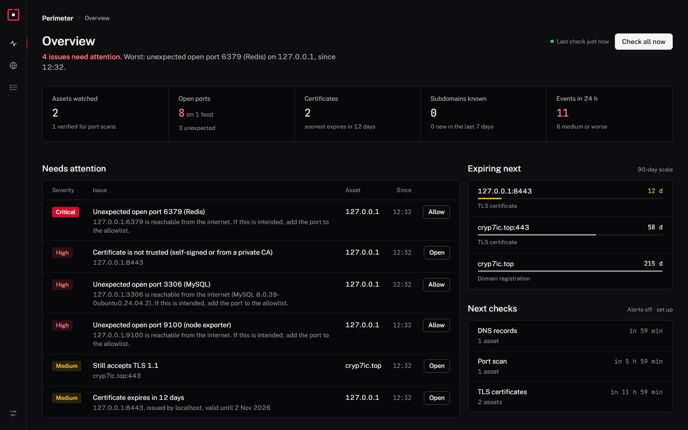
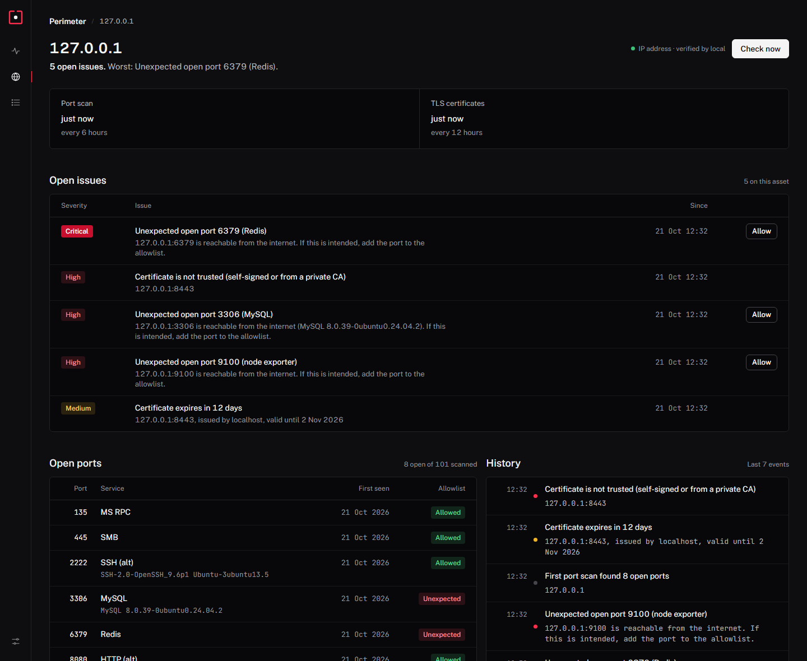

<h1 align="center">Perimeter</h1>

<p align="center"><b>Know what you just exposed to the internet, before someone else does.</b></p>

<p align="center">
  <a href="https://github.com/z6il/perimeter/actions/workflows/ci.yml"></a>
  <a href="https://github.com/z6il/perimeter/releases/latest"></a>
  
  
  
</p>

<p align="center">
  
</p>

**Perimeter** is a small, self-hosted dashboard that watches a company's internet-facing assets. Add your
domains and IP addresses, list the ports that *should* be open, and it tells you when anything else shows
up: an unexpected open port, a certificate or domain about to expire, a DNS record that changed, or a new
subdomain in the certificate logs.

It's for small IT teams, MSPs, startups and homelabs that don't have a security team and don't want to
glue together `cron + nmap + a cert checker + a crt.sh script`. One container, one SQLite file, no account.

## Quick start

```bash
docker run -d --name perimeter -p 8080:8080 -v perimeter-data:/data ghcr.io/z6il/perimeter:latest
docker logs perimeter   # prints the generated admin password on first start
```

Open http://localhost:8080, sign in, and add your first domain. Or use [`compose.yaml`](compose.yaml), or
download a binary for Linux, macOS or Windows from [Releases](https://github.com/z6il/perimeter/releases)
and run `./perimeter`.

## What it watches

| Check | How often | What raises an alert |
|---|---|---|
| **Open ports** | every 6 h | A port that isn't on the asset's allowlist (databases, Docker, Redis and friends are critical); an allowed port that stops answering; a changed service banner |
| **TLS certificates** | every 12 h | Expiring within 21 days, expired, untrusted, a name it doesn't cover, or a server that still accepts TLS 1.0/1.1 |
| **Domain expiry** | every 24 h | Registration ending within 60 days, via RDAP |
| **DNS records** | every hour | A, AAAA, CNAME, MX, NS or TXT changes (a changed NS record is high: it can mean a hijack) |
| **Certificate logs** | every 12 h | A certificate issued for a subdomain you haven't seen before (crt.sh, with Cert Spotter as a fallback) |

Every change lands on a timeline. Medium and worse go to **Telegram, Slack or any webhook** (JSON), with
the minimum level up to you. Failed lookups retry after 30 minutes instead of waiting for the next cycle.

<p align="center">
  
</p>

**Accepting a port takes one click.** Each unexpected port has an **Allow** button that adds it to the
allowlist and clears the alert, so the list of findings stays short and real.

## Ownership first

Port scanning someone else's server is not okay, so Perimeter won't do it:

- **Active checks (port scans) run only on assets you've verified**: a DNS TXT record on the domain, a
  file served from the IP, or, for private addresses (10.x, 192.168.x and so on), a confirmation that
  it's your network. A public IP can't skip the proof.
- **Subdomains inherit verification only when they point at your own servers.** A name that CNAMEs to a
  hosted service (a shop, a help desk, a CDN) needs its own proof, so you never scan a provider by
  accident.
- **Passive checks** (DNS, certificate logs, domain expiry, an HTTPS visit to read the certificate) only
  read public records and start right away.
- Scans are polite: a TCP connect scan of 101 common ports at 32 connections at a time, every 6 hours.

## Security

- One admin password (bcrypt), sessions in `HttpOnly`, `SameSite=Strict` cookies, and every state change
  checked for a same-origin request. Repeated wrong passwords are slowed down and then blocked for 15 minutes.
- A strict Content Security Policy, no inline scripts, and no third-party requests from the browser. The
  fonts are bundled.
- The server talks only to your assets and to crt.sh, Cert Spotter and rdap.org for passive lookups.
- Alert tokens stay in your SQLite file and are never written to logs.

Put it behind your reverse proxy with HTTPS if it's reachable from outside your network.

## Configuration

| Variable | Default | |
|---|---|---|
| `PERIMETER_ADDR` | `:8080` | Listen address |
| `PERIMETER_DATA` | `data` (`/data` in Docker) | Folder for the SQLite database |
| `PERIMETER_PASSWORD` | generated on first start | Sets the admin password on every start |

Alert destinations and the dashboard's public address are set in **Settings**.

## Build from source

```bash
git clone https://github.com/z6il/perimeter && cd perimeter
go test ./... && go build -o perimeter .
```

Go 1.26+. Pure Go, no C compiler needed (SQLite via `modernc.org/sqlite`).

## Roadmap

- A weekly summary email and an HTML report you can send to a client
- Internal-network agents for MSPs watching several sites
- Custom port lists per asset, and a full-range scan on demand
- Export of findings to Wazuh

## License

MIT © 2026 [Abdullah Almuntaser](https://github.com/z6il)
